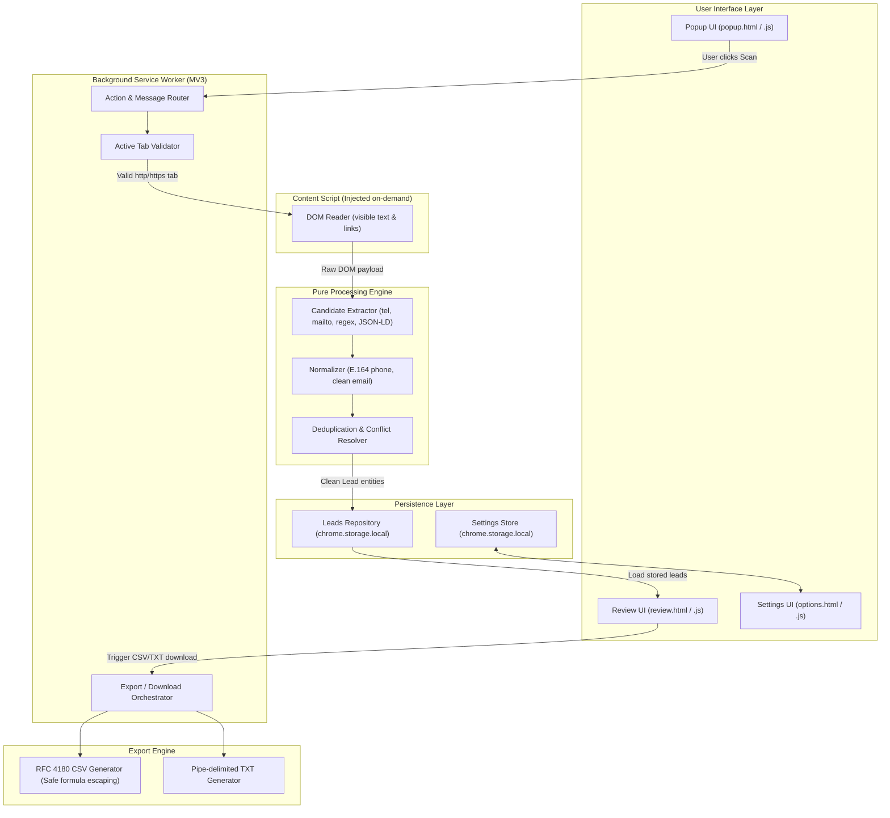
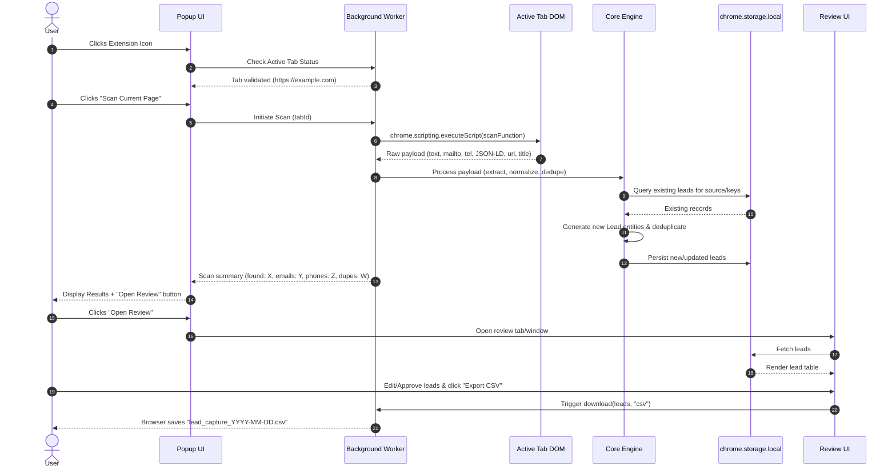

# Architecture & System Design: Lead Generation Browser Extension

This document specifies the technical architecture, component responsibilities, data flow, security model, and directory layout for the **Lead Generation Browser Extension**, in full accordance with the *Technical Project Specification & Implementation Guide*.

---

## 1. Executive Summary & Design Principles

The Lead Generation Browser Extension is an on-device, user-controlled Chromium extension built on **Manifest V3**. It discovers, normalizes, reviews, and selectively exports public contact information visible on active web pages without external telemetry or automated crawling.

### Core Architectural Pillars
- **Zero Remote Telemetry & Local-First**: All processing (extraction, normalization, deduplication, storage) occurs entirely on the user's local machine. No external servers or API calls are used.
- **Strict Least-Privilege**: Permissions are limited to `activeTab`, `scripting`, `storage`, and `downloads`. No persistent broad host permissions are declared in the manifest.
- **Explicit User Initiation**: Scans run only when explicitly triggered by the user via the extension popup ("Scan Current Page"). No background monitoring or automated DOM listeners.
- **Review Before Export**: Extracted candidates are presented in an editable review interface before local persistence and export.
- **Defensive Data Handling**: Formula injection mitigation on CSV exports, XSS prevention via strict DOM text manipulation, and clean separation between uncertain entities.

---

## 2. High-Level Architecture



---

## 3. Component & Module Breakdown

### 3.1. User Interface (UI Layer)
- **Popup (`ui/popup.html`, `ui/popup.js`, `ui/popup.css`)**:
  - **Idle State**: Inspects active tab title/URL, verifies if the URL scheme is supported (`http:`, `https:`), and displays the **Scan Current Page** button.
  - **Results State**: Displays total count found, valid phone/email counts, duplicates ignored, and an **Open Review** button.
  - **Navigation**: Quick links to open Review Manager and Extension Settings.
- **Review Manager (`ui/review.html`, `ui/review.js`, `ui/review.css`)**:
  - Full-page or dedicated tab interface presenting an interactive data table.
  - Features: Checkbox selection (Select All / Invert), inline row editing (names, phone, email, notes), manual deletion, status filtering (`pending`, `approved`, `rejected`), and export triggers.
- **Options / Settings (`ui/options.html`, `ui/options.js`)**:
  - User preferences: default country dialing code, custom phone formatting preference, ignore domains/patterns, and retention rules.
  - **Clear All Data**: Irrevocably clears the local database upon explicit user confirmation.

### 3.2. Background Service Worker (`background/service-worker.js`)
- **Lifecycle**: Stateless MV3 service worker designed to terminate when idle without state loss.
- **Message Routing**: Coordinates communication between Popup, Review UI, and content scripts.
- **Tab Access Validation**: Confirms the active tab is not a restricted URL (`chrome://`, `chrome-extension://`, `about:`, Edge internal pages, or Chrome Web Store).
- **Programmatic Script Injection**: Uses `chrome.scripting.executeScript` to inject the DOM reader function only when a scan is requested.
- **Download Management**: Formats file blobs and invokes `chrome.downloads.download` with proper timestamped filenames.

### 3.3. Content Injection Layer (`content/scan-page.js`)
- Runs ephemerally inside the context of the active tab.
- **DOM Reader Constraints**:
  - Caps text traversal to the first 250,000 characters of `document.body.innerText` to prevent freezing large or complex SPAs.
  - Queries explicit high-confidence DOM elements: `a[href^="mailto:"]` and `a[href^="tel:"]`.
  - Extracts metadata: `document.title`, `location.href`, and embedded JSON-LD scripts (`<script type="application/ld+json">`) for `Organization` schema.
  - Ignores hidden nodes (`display: none`, `visibility: hidden`, `aria-hidden="true"`) where feasible.

### 3.4. Core Engine (`core/`)
Pure, deterministic JavaScript functions without DOM or Chrome API dependencies (enables headless unit testing):
1. **`extract.js`**:
   - Parses `mailto:` and `tel:` URIs (strips query parameters, decoding issues).
   - Scans visible page text with regular expressions for international phone formats and emails.
   - Extracts structured organization name from JSON-LD schema or main `<h1>` headers.
   - Preserves uncertainty: does *not* conflate arbitrary emails and phone numbers into a single person without explicit semantic grouping.
2. **`normalize.js`**:
   - Converts phone numbers to standard E.164 format (using country context).
   - Trims trailing punctuation from emails, converts domain part to lowercase, and strips placeholder values (e.g. `user@example.com`, `name@domain.com`).
3. **`dedupe.js`**:
   - Determines primary candidate keys: canonical phone first, otherwise normalized email.
   - Re-scans against existing repository records to prevent duplicate row creation.
   - Protects existing user-reviewed/edited records from being overwritten on subsequent scans.

### 3.5. Storage Repository (`storage/leads-repository.js`)
- Interfaces with `chrome.storage.local`.
- Encapsulates schema versioning (e.g. `schemaVersion: 1`), migrations, and CRUD operations:
  - `saveLeads(leads: Lead[])`
  - `getLeads(filter?: QueryFilter): Promise<Lead[]>`
  - `updateLead(id: string, updates: Partial<Lead>)`
  - `deleteLeads(ids: string[])`
  - `clearAll()`

### 3.6. Exporter (`export/`)
- **`csv.js`**:
  - Compliant with **RFC 4180**: fields with commas, quotes, or newlines are enclosed in double quotes; nested quotes are escaped by doubling (`""`).
  - **CSV Formula Injection Mitigation**: Any field starting with formula execution trigger characters (`=`, `+`, `-`, `@`) is safely prefixed with a single quote (`'`).
  - Prepends UTF-8 BOM (`\uFEFF`) to ensure clean rendering of international characters in Microsoft Excel.
- **`txt.js`**:
  - Formats records into clean pipe-delimited lines:
    `Business/Contact | Phone | Email | Source URL`

---

## 4. End-to-End Execution Flow



---

## 5. Data Models & TypeScript Definitions

```typescript
export type ConfidenceLevel = "high" | "medium" | "low";
export type ReviewStatus = "pending" | "approved" | "rejected";

export interface Lead {
  id: string;                     // UUID v4
  businessName?: string;          // Inferred from JSON-LD, H1, or title
  contactName?: string;           // Optional parsed personal name
  phone?: string;                 // Canonicalized E.164 format (+1XXXXXXXXXX)
  email?: string;                 // Validated syntax, lowercased domain
  website?: string;               // Extracted or domain of source
  sourceUrl: string;              // Full URL of the captured page (mandatory)
  sourceTitle?: string;           // Page title for provenance
  capturedAt: string;             // ISO 8601 UTC timestamp
  confidence: ConfidenceLevel;    // Extraction confidence score
  reviewStatus: ReviewStatus;     // Review state
  notes?: string;                 // User-editable notes
}

export interface RawExtractionPayload {
  text: string;                   // Document innerText (max 250k chars)
  emails: string[];               // Extracted mailto: link targets
  phones: string[];               // Extracted tel: link targets
  jsonLdOrgs: string[];           // Names from JSON-LD schema
  title: string;                  // document.title
  url: string;                    // location.href
}

export interface ExtensionSettings {
  defaultCountry: string;         // Default ISO 3166-1 alpha-2 for phone parsing (e.g., "US")
  stripTrackingParams: boolean;   // Clean tracking query params from sourceUrl
  ignoreDomains: string[];        // Blacklisted domains or placeholder email patterns
  exportSafeFormulas: boolean;    // Prefix =, +, -, @ on CSV export (default true)
  schemaVersion: number;          // DB schema migration tracker
}
```

---

## 6. Security, Privacy & Permission Boundary

| Concern | Implementation Defense |
| :--- | :--- |
| **Least Privilege** | Manifest specifies only `activeTab`, `scripting`, `storage`, and `downloads`. No persistent `host_permissions` wildcard (`<all_urls>`). |
| **Restricted Pages** | Pre-scan checks block execution on `chrome://`, `chrome-extension://`, `about:`, Edge internal URLs, and the Chrome Web Store. |
| **XSS Prevention** | No user-derived or page-extracted content is ever inserted via `innerHTML`. All UI rendering uses `textContent` or `document.createElement`. |
| **CSV Formula Injection** | Fields beginning with `=`, `+`, `-`, or `@` are escaped with a leading single quote `'` before generating CSV rows. |
| **Zero Telemetry** | No outbound `fetch` or `XMLHttpRequest` to remote endpoints. No third-party SDKs, tracking pixels, or remote scripts. |
| **Scraping Ethics** | Strictly manual on-page extraction. No auto-scrolling, no CAPTCHA circumvention, and no scraping behind unauthorized logins. |

---

## 7. Error Handling & Edge Cases

1. **Restricted Browser Pages**:
   - When clicked on browser internal pages, the popup immediately disables the scan button and displays a non-blocking warning: *"This page cannot be scanned due to browser security restrictions."*
2. **Missing Document Body or Large SPAs**:
   - If `document.body` is null or detached, returns an empty payload gracefully.
   - Text extraction is capped at 250,000 characters to prevent memory spikes and UI thread freezing.
3. **Malformed Links & Syntax**:
   - `mailto:` and `tel:` href values are sanitized to remove prefixes and query strings (`?subject=...`).
   - Emails matching standard bogus patterns (`example.com`, `user@domain`, `test@test.com`) are rejected.
4. **Duplicate Scans**:
   - If the same page is scanned multiple times, deduplication logic recognizes matching `phone` or `email` tied to the same `sourceUrl` and updates rather than duplicates records.

---

## 8. Testing Strategy & Test Matrix

The codebase is structured to allow comprehensive unit and integration testing without requiring a live browser:

| Test Suite | File | Focus Areas |
| :--- | :--- | :--- |
| **Extraction Unit Tests** | `tests/extraction.test.js` | Regex precision, `mailto:`/`tel:` parsing, JSON-LD extraction, ignoring placeholder values. |
| **Normalization Unit Tests**| `tests/normalize.test.js` | E.164 phone conversion, international prefixes, email domain lowercasing. |
| **Deduplication Tests** | `tests/dedupe.test.js` | Deduplication by phone/email candidate keys, preserving user modifications. |
| **Export Unit Tests** | `tests/export.test.js` | RFC 4180 compliance, formula injection escaping, UTF-8 BOM encoding. |
| **Synthetic Fixtures** | `tests/fixtures/*.html` | Static HTML files for business contacts, zero contacts, malformed links, and Unicode names. |

---

## 9. Implementation Roadmap & Directory Mapping

```text
LeadGenerationExtension/
├── manifest.json              # MV3 Manifest with minimal permissions
├── package.json               # Development tooling & test scripts
├── architecture.md            # System architecture (this document)
├── README.md                  # Installation, usage guide, and privacy disclosure
├── background.js              # Service worker (action routing, tab check, injection)
├── content.js                 # Content injection script (DOM extractor)
├── core/
│   ├── extract.js             # Pure extraction logic
│   ├── normalize.js           # E.164 phone & email normalization
│   ├── dedupe.js              # Deduplication engine
│   └── types.js               # Type schemas & constants
├── storage/
│   └── repository.js          # chrome.storage.local abstraction
├── export/
│   ├── csv.js                 # RFC 4180 CSV builder with formula protection
│   └── txt.js                 # Pipe-delimited TXT builder
├── ui/
│   ├── popup.html / .js / .css    # User scan popup
│   ├── review.html / .js / .css   # Lead review & table editor
│   └── options.html / .js / .css  # Settings & clear data
└── tests/
    ├── fixtures/                  # Synthetic HTML test fixtures
    └── test-runner.js             # Automated unit tests
```

